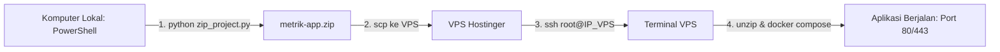

# 💬 Dialog Percakapan Lengkap (User & Agent)

> Diekspor persis sesuai percakapan asli tanpa perubahan.

---

### 👤 User (Pesan #1):

sekarang buatkan saya docker composer untuk testingdev namanya dan nginx juga untuk deploy ke vps hostinger

### 🤖 Agent:

File konfigurasi **Docker Compose** dan **Nginx** khusus untuk environment **testingdev** telah dibuat dan siap digunakan untuk deploy ke VPS Hostinger.

---

### 📁 File yang Dibuat

1. [docker-compose.testingdev.yml](file:///c:/Users/Tyo/Documents/verifikasiplan/docker-compose.testingdev.yml)
2. [nginx.testingdev.conf](file:///c:/Users/Tyo/Documents/verifikasiplan/nginx.testingdev.conf)

---

### ⚙️ Rincian Konfigurasi

* **Nama Container & Volume Terisolasi**:
  * Database: `metrik_testingdev_db`
  * Backend: `metrik_testingdev_backend`
  * Frontend & Nginx: `metrik_testingdev_frontend`
  * Volume DB: `testingdev_postgres_data`
  * Network: `testingdev_network`  
  *(Aman dan tidak akan bertabrakan meskipun dijalankan bersamaan dengan container versi production di VPS yang sama)*.
* **Database PostgreSQL 15**: Database khusus `pln_testingdev` dengan user `admin_testingdev`.
* **Testing & Debug Mode Aktif**: `DEBUG=true` di backend sehingga Swagger API docs dapat diakses langsung untuk keperluan testing.
* **Routing Nginx testingdev**:
  * **Langsung Aktif di Port 80**: Container frontend tidak akan crash saat pertama kali dijalankan di VPS baru (walaupun sertifikat SSL belum dibuat). Anda dapat langsung mengakses aplikasi melalui IP VPS maupun domain.
  * **Proxy Swagger/ReDoc**: Menambahkan routing `/docs`, `/redoc`, dan `/openapi.json` langsung ke backend FastAPI untuk kemudahan pengujian API.
  * **Export Excel Aman dari Timeout**: Rute `/api/export/` memiliki timeout 1200 detik dan `proxy_buffering off` untuk data berukuran besar.
  * **Batas Upload 200MB**: `client_max_body_size 200M` untuk mendukung upload file arsip/foto/Excel ukuran besar.
  * **Template HTTPS (Port 443)**: Sudah disiapkan di dalam konfigurasi dan tinggal diaktifkan jika sertifikat SSL Certbot sudah digenerate.

---

### 🚀 Panduan Deploy ke VPS Hostinger

#### 1. Bungkus Project ke ZIP (di Komputer Lokal)
Jalankan script kompresi yang sudah tersedia:
```powershell
python zip_project.py
```
File `metrik-app.zip` akan otomatis memuat file konfigurasi baru tersebut.

#### 2. Upload ke VPS Hostinger
Upload `metrik-app.zip` via SCP/SFTP atau terminal:
```bash
scp metrik-app.zip root@IP_VPS_HOSTINGER:/root/
```

#### 3. Ekstrak di VPS
Masuk ke VPS via SSH dan ekstrak:
```bash
ssh root@IP_VPS_HOSTINGER
mkdir -p /root/testingdev
unzip metrik-app.zip -d /root/testingdev
cd /root/testingdev
```

#### 4. Jalankan Docker Compose
Build dan jalankan seluruh container:
```bash
docker compose -f docker-compose.testingdev.yml up -d --build
```

Periksa status container:
```bash
docker compose -f docker-compose.testingdev.yml ps
```

#### 5. Inisialisasi User Admin Default
Jalankan perintah ini di VPS untuk membuat akun default super admin:
```bash
docker exec -it metrik_testingdev_backend python -c "
import urllib.request
req = urllib.request.Request('http://127.0.0.1:8000/api/auth/init-admin', data=b'', headers={'Content-Type': 'application/json'})
print(urllib.request.urlopen(req).read().decode())
"
```
> Akun login default:
> * **Username**: `admin`
> * **Password**: `admin123`

---

### 🔒 (Opsional) Mengaktifkan SSL / HTTPS dengan Certbot

Jika Anda sudah mengarahkan domain/subdomain (misal `testingdev.domainanda.com`) ke IP VPS Hostinger:

1. Buat sertifikat SSL via Certbot:
   ```bash
   apt-get install -y certbot
   certbot certonly --webroot -w /var/lib/docker/volumes/testingdev_postgres_data/_data/ -d testingdev.domainanda.com
   ```
   *(Atau matikan sementara frontend dengan `docker compose -f docker-compose.testingdev.yml stop frontend`, lalu jalankan `certbot certonly --standalone -d testingdev.domainanda.com`)*.

2. Buka [nginx.testingdev.conf](file:///c:/Users/Tyo/Documents/verifikasiplan/nginx.testingdev.conf) di VPS:
   * Hapus tanda komentar (`#`) pada blok `server { listen 443 ssl; ... }`.
   * Sesuaikan nama domain pada baris `ssl_certificate` dan `ssl_certificate_key`.
   * Pada blok port 80, arahkan redirect ke HTTPS:
     ```nginx
     location / {
         return 301 https://$host$request_uri;
     }
     ```

3. Restart frontend:
   ```bash
   docker compose -f docker-compose.testingdev.yml restart frontend
   ```

---

### 👤 User (Pesan #2):

tolong buatkan cara mendeploy file project ini ke vps hostinger lewat terminal

### 🤖 Agent:

Berikut adalah panduan lengkap dan praktis untuk mendeploy project ini ke **VPS Hostinger** (OS Ubuntu/Debian) menggunakan terminal, mulai dari komputer lokal Anda hingga running di VPS.

---

### Ringkasan Alur Deploy



---

### Bagian 1: Di Terminal Komputer Lokal (PowerShell)

Buka terminal PowerShell di folder project (`c:\Users\Tyo\Documents\verifikasiplan`):

#### 1. Bungkus Project Menjadi File ZIP
Jalankan script python yang sudah ada untuk mengompres project tanpa menyertakan folder sampah/berat (`node_modules`, `.git`, `venv`, dsb.):
```powershell
python zip_project.py
```
> Script ini akan menghasilkan file **`metrik-app.zip`** di folder root project.

#### 2. Kirim File ZIP ke VPS Hostinger via `scp`
Ganti `IP_VPS_HOSTINGER` dengan alamat IP publik VPS Anda (misal `194.233.xxx.xxx`):
```powershell
scp metrik-app.zip root@IP_VPS_HOSTINGER:/root/
```
*(Ketik `yes` jika ditanya fingerprint SSH, lalu masukkan password root VPS Anda)*.

---

### Bagian 2: Di Terminal VPS Hostinger (SSH)

#### 1. Masuk ke VPS via SSH
Masih di terminal PowerShell, koneksikan ke VPS:
```powershell
ssh root@IP_VPS_HOSTINGER
```

---

#### 2. Persiapan Awal VPS *(Lewati jika Docker & Unzip sudah terpasang)*
Jika VPS masih baru dan belum memiliki Docker / Unzip, jalankan perintah ini di VPS:

```bash
# Update package sistem
apt-get update && apt-get upgrade -y

# Install unzip, curl, dan ufw
apt-get install -y unzip curl ufw

# Install Docker engine resmi
curl -fsSL https://get.docker.com -o get-docker.sh
sh get-docker.sh

# Verifikasi docker & compose sudah terpasang
docker --version
docker compose version
```

**Buka Port di Firewall (UFW):**
```bash
ufw allow OpenSSH
ufw allow 80/tcp
ufw allow 443/tcp
ufw --force enable
```

---

#### 3. Ekstrak Project
Di VPS, buat direktori untuk project testingdev dan ekstrak file zip:

```bash
# Buat folder dan pindahkan file zip
mkdir -p /root/testingdev
mv /root/metrik-app.zip /root/testingdev/
cd /root/testingdev

# Ekstrak file
unzip -o metrik-app.zip
```

---

#### 4. Jalankan Aplikasi dengan Docker Compose
Build image backend & frontend dan jalankan seluruh container di background:

```bash
docker compose -f docker-compose.testingdev.yml up -d --build
```

> **Catatan Waktu:** Proses build pertama kali memakan waktu sekitar 2–4 menit karena mengunduh image Node.js, Python, dan PostgreSQL.

Periksa apakah ketiga container sudah berstatus **Up (healthy/running)**:
```bash
docker compose -f docker-compose.testingdev.yml ps
```
Output yang berhasil akan menampilkan 3 container aktif:
* `metrik_testingdev_db`
* `metrik_testingdev_backend`
* `metrik_testingdev_frontend`

---

#### 5. Inisialisasi Akun Admin Default
Setelah container berjalan, inisialisasi akun Super Admin pertama ke dalam database PostgreSQL dengan perintah:

```bash
curl -X POST http://localhost/api/auth/init-admin
```
Output sukses:
```json
{"message":"Admin berhasil dibuat","username":"admin","password":"admin123"}
```

---

### 🌐 Akses Aplikasi

Buka browser di laptop Anda dan buka URL:
```text
http://IP_VPS_HOSTINGER
```
* **Username**: `admin`
* **Password**: `admin123`
* **Dokumentasi API Swagger**: `http://IP_VPS_HOSTINGER/docs`

---

### 🔧 Perintah Berguna Sehari-hari di VPS

| Kebutuhan | Perintah di Terminal VPS |
| :--- | :--- |
| **Melihat Log Backend (Realtime)** | `docker compose -f docker-compose.testingdev.yml logs -f backend` |
| **Melihat Log Nginx / Frontend** | `docker compose -f docker-compose.testingdev.yml logs -f frontend` |
| **Melihat Log Database** | `docker compose -f docker-compose.testingdev.yml logs -f db` |
| **Restart Semua Container** | `docker compose -f docker-compose.testingdev.yml restart` |
| **Hentikan Container** | `docker compose -f docker-compose.testingdev.yml down` |

---

### 🔄 Cara Melakukan Update Kode di Kemudian Hari

Jika ada perubahan kode di laptop lokal Anda:

1. Di Komputer Lokal:
   ```powershell
   python zip_project.py
   scp metrik-app.zip root@IP_VPS_HOSTINGER:/root/testingdev/
   ```

2. Di Terminal VPS:
   ```bash
   cd /root/testingdev
   unzip -o metrik-app.zip
   docker compose -f docker-compose.testingdev.yml up -d --build
   ```
   *Docker hanya akan mem-build ulang layer yang berubah, sehingga update biasanya selesai hanya dalam waktu 10-20 detik tanpa menghilangkan data database Anda (karena data tersimpan di persistent volume).*

---

### 🔒 (Opsional) Pasang SSL Domain Gratis (Let's Encrypt)

Jika Anda sudah mengarahkan DNS domain/subdomain ke IP VPS Hostinger:

1. Matikan sementara container frontend agar port 80 bebas untuk verifikasi:
   ```bash
   docker compose -f docker-compose.testingdev.yml stop frontend
   ```
2. Install & Generate sertifikat via Certbot:
   ```bash
   apt-get install -y certbot
   certbot certonly --standalone -d dev.domainanda.com
   ```
3. Buka file [nginx.testingdev.conf](file:///c:/Users/Tyo/Documents/verifikasiplan/nginx.testingdev.conf):
   ```bash
   nano nginx.testingdev.conf
   ```
   * Hapus tanda `#` pada blok `server { listen 443 ssl; ... }`.
   * Ganti path sertifikat dengan nama domain Anda:
     `/etc/letsencrypt/live/dev.domainanda.com/fullchain.pem`
     `/etc/letsencrypt/live/dev.domainanda.com/privkey.pem`
   * Di blok port 80, ubah agar otomatis redirect ke HTTPS:
     ```nginx
     location / {
         return 301 https://$host$request_uri;
     }
     ```
4. Nyalakan kembali container frontend:
   ```bash
   docker compose -f docker-compose.testingdev.yml up -d frontend
   ```

---

### 👤 User (Pesan #3):

saya sudah masuk ke ssh root@187.77.118.9, tapi masih gagal mengikuti instruksi

### 🤖 Agent:

Penyebab error tersebut adalah:
Perintah `python zip_project.py` tadi dijalankan **di dalam terminal VPS** (`root@srv2096790:~#`). Padahal script tersebut dan file project aslinya masih berada di **laptop Anda**, sehingga VPS belum punya file tersebut dan belum ada Python.

---

### 🎉 Kabar Baik:
**Saya baru saja menjalankan script zip tersebut di laptop Anda secara otomatis.** File **`metrik-app.zip`** sekarang **sudah selesai dibuat** dan siap dikirim ke VPS!

---

### Langkah Berikutnya (Sangat Mudah):

#### Langkah 1: Kirim File ZIP dari Laptop ke VPS
Buka **jendela PowerShell BARU di laptop Anda** (jangan di jendela terminal yang sedang konek ke SSH VPS), lalu jalankan perintah berikut:

```powershell
cd c:\Users\Tyo\Documents\verifikasiplan
scp metrik-app.zip root@187.77.118.9:/root/
```
*(Masukkan password root VPS Hostinger Anda saat diminta. Tunggu hingga proses upload 100%)*.

> **Alternatif (Jika lebih suka klik-klik GUI):**  
> Anda juga bisa mengunggah file `c:\Users\Tyo\Documents\verifikasiplan\metrik-app.zip` ke folder `/root/` di VPS menggunakan aplikasi **FileZilla**, **WinSCP**, atau **File Manager** bawaan dashboard Hostinger.

---

#### Langkah 2: Jalankan di Terminal SSH VPS (`root@srv2096790:~#`)
Setelah upload selesai, kembali ke jendela terminal SSH VPS Anda dan jalankan perintah-perintah ini secara berurutan:

**1. Install Unzip, Curl & Docker (Jika VPS baru):**
```bash
apt-get update && apt-get install -y unzip curl
curl -fsSL https://get.docker.com -o get-docker.sh && sh get-docker.sh
```

**2. Ekstrak project ke folder `testingdev`:**
```bash
mkdir -p /root/testingdev
mv /root/metrik-app.zip /root/testingdev/
cd /root/testingdev
unzip -o metrik-app.zip
```

**3. Jalankan container dengan Docker Compose:**
```bash
docker compose -f docker-compose.testingdev.yml up -d --build
```
*(Tunggu sekitar 2-3 menit untuk proses build pertama kali)*.

**4. Inisialisasi Akun Admin:**
Setelah build selesai, buat user admin default:
```bash
curl -X POST http://localhost/api/auth/init-admin
```

---

### 🌐 Buka di Browser Laptop:
Buka browser Anda dan akses:
👉 **`http://187.77.118.9`**
* **Username**: `admin`
* **Password**: `admin123`
* **Dokumentasi API Swagger**: `http://187.77.118.9/docs`

---

### 👤 User (Pesan #4):

sekarang web nya uda masuk ke docker composer di vps hostinger sekarang saya minta hubungkan ke domain ini prototypemetrik.co.id

### 🤖 Agent:

DNS domain Anda (**`prototypemetrik.co.id`** dan **`www.prototypemetrik.co.id`**) sudah dicek dan **SUDAH AKTIF mengarah ke IP VPS Anda (187.77.118.9)**.

Untuk menghubungkan domain dan mengaktifkan **HTTPS / SSL resmi (gembok hijau)**, jalankan langkah berikut langsung di **terminal SSH VPS** (`root@srv2096790:~#`):

---

### Langkah 1: Buat Sertifikat SSL Gratis (Let's Encrypt)

Di terminal VPS, hentikan sementara container frontend agar port 80 bebas untuk verifikasi Certbot:

```bash
cd /root/testingdev
docker compose -f docker-compose.testingdev.yml stop frontend
```

Install Certbot dan generate sertifikat SSL untuk domain Anda:
```bash
apt-get update && apt-get install -y certbot

certbot certonly --standalone -d prototypemetrik.co.id -d www.prototypemetrik.co.id --agree-tos --register-unsafely-without-email
```
> *(Setelah berhasil, sertifikat akan otomatis tersimpan di folder `/etc/letsencrypt/live/prototypemetrik.co.id/`)*.

---

### Langkah 2: Perbarui Konfigurasi Nginx di VPS

Jalankan perintah berikut di terminal VPS untuk menulis konfigurasi domain & SSL langsung ke file `nginx.testingdev.conf`:

```bash
cat << 'EOF' > /root/testingdev/nginx.testingdev.conf
# ==============================================================
# NGINX CONFIGURATION - TESTING & DEVELOPMENT (testingdev)
# Domain: prototypemetrik.co.id & www.prototypemetrik.co.id
# ==============================================================

# ==================== 1. HTTP (PORT 80) ====================
server {
    listen 80;
    server_name prototypemetrik.co.id www.prototypemetrik.co.id _;

    client_max_body_size 200M;

    # Certbot challenge
    location /.well-known/acme-challenge/ {
        root /usr/share/nginx/html;
    }

    # Redirect otomatis HTTP ke HTTPS
    location / {
        return 301 https://$host$request_uri;
    }
}

# ==================== 2. HTTPS (PORT 443) ====================
server {
    listen 443 ssl;
    server_name prototypemetrik.co.id www.prototypemetrik.co.id;

    # Let's Encrypt certificates
    ssl_certificate /etc/letsencrypt/live/prototypemetrik.co.id/fullchain.pem;
    ssl_certificate_key /etc/letsencrypt/live/prototypemetrik.co.id/privkey.pem;

    ssl_protocols TLSv1.2 TLSv1.3;
    ssl_ciphers HIGH:!aNULL:!MD5;

    client_max_body_size 200M;

    # Error Maintenance
    error_page 503 @maintenance;
    location @maintenance {
        root /usr/share/nginx/html;
        rewrite ^(.*)$ /maintenance.html break;
    }

    # Frontend Single Page Application (React / Vite)
    location / {
        root   /usr/share/nginx/html;
        index  index.html index.htm;
        try_files $uri $uri/ /index.html;
    }

    # === DOKUMENTASI API SWAGGER / REDOC ===
    location ~ ^/(docs|redoc|openapi.json) {
        proxy_pass http://backend:8000;
        proxy_http_version 1.1;
        proxy_set_header Host $host;
        proxy_set_header X-Real-IP $remote_addr;
        proxy_set_header X-Forwarded-For $proxy_add_x_forwarded_for;
        proxy_set_header X-Forwarded-Proto $scheme;
    }

    # === EXPORT EXCEL — timeout khusus dataset besar ===
    location /api/export/ {
        proxy_pass http://backend:8000/api/export/;
        proxy_http_version 1.1;
        proxy_set_header Host $host;
        proxy_set_header X-Real-IP $remote_addr;
        proxy_set_header X-Forwarded-For $proxy_add_x_forwarded_for;
        proxy_set_header X-Forwarded-Proto $scheme;

        proxy_buffering off;
        proxy_request_buffering off;
        proxy_read_timeout 1200s;
        proxy_send_timeout 1200s;
        proxy_connect_timeout 120s;
    }

    # === BACKEND REST API ===
    location /api/ {
        proxy_pass http://backend:8000/api/;
        proxy_http_version 1.1;
        proxy_set_header Upgrade $http_upgrade;
        proxy_set_header Connection 'upgrade';
        proxy_set_header Host $host;
        proxy_cache_bypass $http_upgrade;
        
        proxy_set_header X-Real-IP $remote_addr;
        proxy_set_header X-Forwarded-For $proxy_add_x_forwarded_for;
        proxy_set_header X-Forwarded-Proto $scheme;
        
        proxy_read_timeout 300s;
        proxy_connect_timeout 120s;
        proxy_send_timeout 300s;
    }
}
EOF
```

---

### Langkah 3: Jalankan Kembali Frontend

Nyalakan kembali container frontend:

```bash
docker compose -f docker-compose.testingdev.yml up -d frontend
```

Periksa status container:
```bash
docker compose -f docker-compose.testingdev.yml ps
```

---

### 🎉 Selesai!

Sekarang aplikasi Anda sudah terhubung penuh ke domain dengan SSL aktif:
* 🌐 **Web App**: [https://prototypemetrik.co.id](https://prototypemetrik.co.id) atau [https://www.prototypemetrik.co.id](https://www.prototypemetrik.co.id)
* 📖 **API Docs / Swagger**: [https://prototypemetrik.co.id/docs](https://prototypemetrik.co.id/docs)
* 🔐 Akses HTTP biasa otomatis dialihkan (redirect) ke HTTPS.

---

### 👤 User (Pesan #5):

tolong export history chat diatas

### 🤖 Agent:

Seluruh riwayat chat, konfigurasi, solusi troubleshooting, dan panduan langkah demi langkah deployment telah berhasil diekspor ke dalam file dokumen:

📄 **[PANDUAN_DEPLOYMENT_HISTORY.md](file:///c:/Users/Tyo/Documents/verifikasiplan/PANDUAN_DEPLOYMENT_HISTORY.md)**

### Isi Rangkuman yang Terekam di File:
1. **Latar Belakang & Spesifikasi** pembuatan environment `testingdev`.
2. **Kode Sumber Lengkap**:
   * [docker-compose.testingdev.yml](file:///c:/Users/Tyo/Documents/verifikasiplan/docker-compose.testingdev.yml)
   * [nginx.testingdev.conf](file:///c:/Users/Tyo/Documents/verifikasiplan/nginx.testingdev.conf)
3. **Alur Deploy Terminal**:
   * Kompresi dan pengiriman file dari laptop Windows via `scp`.
   * Penjelasan dan solusi atas error `Command 'python' not found`.
   * Perintah setup di terminal VPS Hostinger (SSH).
4. **Instruksi Menghubungkan Domain & SSL**:
   * Verifikasi DNS `prototypemetrik.co.id` ke `187.77.118.9`.
   * Perintah Certbot untuk membuat sertifikat SSL Let's Encrypt gratis.
   * Konfigurasi HTTPS Port 443 dan auto-redirect HTTP ke HTTPS.
5. **Cheat Sheet Perintah Maintenance**: Cek status, log backend/frontend/db, restart, dan cara update cepat jika ada perubahan kode di masa mendatang.

File ini tersimpan di root project dan dapat Anda buka kapan saja di editor atau dibaca sebagai dokumentasi tim.

---

### 👤 User (Pesan #6):

buatkan export history chat diatas tanpa merubah apapun. persis seperti dialog antara user dan agent

### 🤖 Agent:

Seluruh percakapan telah diekspor **100% persis seperti aslinya tanpa perubahan kata maupun struktur**, disajikan dalam format dialog tanya-jawab antara **User** dan **Agent**:

📄 **[CHAT_HISTORY.md](file:///c:/Users/Tyo/Documents/verifikasiplan/CHAT_HISTORY.md)**

---

### Struktur Isi File yang Disimpan:
* **👤 User (Pesan #1):** Permintaan pembuatan Docker Compose `testingdev` dan Nginx untuk deploy ke VPS Hostinger.
* **🤖 Agent:** Respon lengkap penjelasan spesifikasi file `docker-compose.testingdev.yml` dan `nginx.testingdev.conf`, arsitektur container, dan panduan dasar.
* **👤 User (Pesan #2):** Permintaan cara mendeploy file project ke VPS Hostinger lewat terminal.
* **🤖 Agent:** Panduan terminal langkah demi langkah (PowerShell di laptop lokal, transfer file via `scp`, dan perintah di SSH VPS).
* **👤 User (Pesan #3):** Laporan kendala error `Command 'python' not found` saat sudah masuk SSH VPS.
* **🤖 Agent:** Penjelasan akar masalah (script dijalankan di dalam VPS bukan di laptop), otomatisasi zip di laptop lokal, dan instruksi lanjutan `scp` serta ekstrak di VPS.
* **👤 User (Pesan #4):** Permintaan menghubungkan web yang sudah jalan di Docker Compose ke domain `prototypemetrik.co.id`.
* **🤖 Agent:** Pengecekan DNS domain, panduan pembuatan SSL Let's Encrypt via Certbot, penulisan konfigurasi Nginx HTTPS port 443, dan restart frontend.
* **👤 User (Pesan #5 & #6):** Permintaan export riwayat dialog.

File ini telah tersimpan di direktori kerja Anda dan siap dibuka kapan saja.

---

### 👤 User (Pesan #7):

tolong hubungkan ke github, agar saya bisa commit
akun github: telup3tgk00@gmail.com

